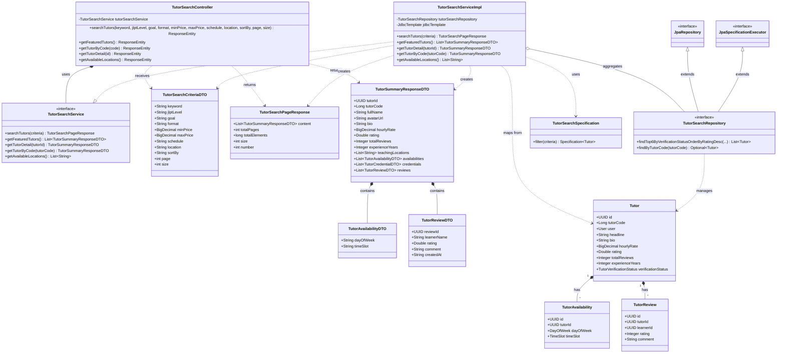
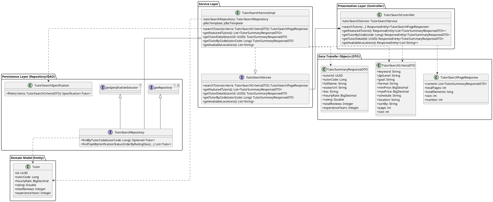

# Class Diagram - Feature 4 & Feature 5 (KizunaTutor)

Tài liệu này cung cấp sơ đồ lớp (Class Diagram) chi tiết cho **Feature 4 (Tìm kiếm và khám phá gia sư - FE-04)** và **Feature 5 (Đăng ký học thử 1-1 và kết nối - FE-05)** theo đúng cấu trúc phân tầng (Controller - DTO - Service - Repository/DAO - Entity - Security) từ mã nguồn thực tế của dự án.

---

## 1. Feature 4: Tìm kiếm & Khám phá gia sư (`tutor_search`)

### 1.1. Sơ đồ Mermaid

### 1.2. Mã nguồn PlantUML (Sao chép vào PlantUML / Word)

---

## 2. Feature 5: Đăng ký học thử & Kết nối (`booking`)

### 2.1. Sơ đồ Mermaid

```mermaid
classDiagram
    direction TB

    %% Controller & Security
    class TrialBookingController {
        -TrialBookingService trialBookingService
        -JwtTokenProvider jwtTokenProvider
        +createTrialBooking(requestDto, request) ResponseEntity
        +respondTrialBooking(bookingId, requestDto, request) ResponseEntity
        +getMyTrialBookings(status, page, size, request) ResponseEntity
        +getTrialBookingDetail(bookingId, request) ResponseEntity
        +cancelTrialBooking(bookingId, requestDto, request) ResponseEntity
    }

    class JwtTokenProvider {
        +getUsernameFromJWT(token) String
        +validateToken(token) boolean
    }

    %% Service Layer
    class TrialBookingService {
        <<interface>>
        +createTrialBooking(userEmail, request) TrialBookingResponseDTO
        +respondTrialBooking(userEmail, bookingId, request) TrialBookingResponseDTO
        +getMyTrialBookings(userEmail, status, page, size) Page~TrialBookingResponseDTO~
        +getTrialBookingDetail(userEmail, bookingId) TrialBookingResponseDTO
        +cancelTrialBooking(userEmail, bookingId, request) TrialBookingResponseDTO
    }

    class TrialBookingServiceImpl {
        -UserRepository userRepository
        -LearnerRepository learnerRepository
        -TutorRepository tutorRepository
        -ConnectionRequestRepository connectionRequestRepository
        -TrialBookingRepository trialBookingRepository
        -TrialBookingHistoryRepository trialBookingHistoryRepository
        +createTrialBooking(userEmail, request) TrialBookingResponseDTO
        +respondTrialBooking(userEmail, bookingId, request) TrialBookingResponseDTO
        +getMyTrialBookings(userEmail, status, page, size) Page~TrialBookingResponseDTO~
        +getTrialBookingDetail(userEmail, bookingId) TrialBookingResponseDTO
        +cancelTrialBooking(userEmail, bookingId, request) TrialBookingResponseDTO
    }

    %% DTOs
    class CreateTrialBookingRequestDTO {
        +UUID tutorId
        +OffsetDateTime scheduledStartTime
        +Integer durationMinutes
        +String learningMode
        +String currentLevel
        +String initialMessage
    }

    class RespondTrialBookingRequestDTO {
        +String action
        +String meetingLink
        +String note
    }

    class CancelTrialBookingRequestDTO {
        +String reason
    }

    class TrialBookingResponseDTO {
        +UUID bookingId
        +UUID requestId
        +UUID learnerId
        +String learnerName
        +UUID tutorId
        +String tutorName
        +OffsetDateTime scheduledStartTime
        +OffsetDateTime scheduledEndTime
        +Integer durationMinutes
        +TrialBookingStatus status
        +String meetingLink
        +String cancellationReason
    }

    %% Repositories / DAOs
    class JpaRepository {
        <<interface>>
    }

    class TrialBookingRepository {
        <<interface>>
        +findByBookingId(id) Optional~TrialBooking~
        +existsOverlappingBooking(tutorId, start, end) boolean
        +findByTutor_Id(tutorId, pageable) Page~TrialBooking~
        +findByLearner_Id(learnerId, pageable) Page~TrialBooking~
    }

    class ConnectionRequestRepository {
        <<interface>>
        +findByRequestId(id) Optional~ConnectionRequest~
        +findByLearnerIdAndTutorId(learnerId, tutorId) Optional~ConnectionRequest~
    }

    class TrialBookingHistoryRepository {
        <<interface>>
        +findByBooking_BookingIdOrderByCreatedAtDesc(id) List~TrialBookingHistory~
    }

    %% Entities & Enums
    class TrialBooking {
        +UUID bookingId
        +ConnectionRequest connectionRequest
        +Learner learner
        +Tutor tutor
        +OffsetDateTime scheduledStartTime
        +OffsetDateTime scheduledEndTime
        +Integer durationMinutes
        +TrialBookingStatus status
        +String meetingLink
        +String cancellationReason
    }

    class ConnectionRequest {
        +UUID requestId
        +UUID learnerId
        +UUID tutorId
        +ConnectionRequestStatus status
        +OffsetDateTime requestedAt
        +OffsetDateTime respondedAt
    }

    class TrialBookingHistory {
        +UUID historyId
        +TrialBooking booking
        +TrialBookingStatus fromStatus
        +TrialBookingStatus toStatus
        +UUID changedBy
        +String changeReason
    }

    class TrialBookingStatus {
        <<enumeration>>
        PENDING
        CONFIRMED
        COMPLETED
        CANCELLED
    }

    class ConnectionRequestStatus {
        <<enumeration>>
        PENDING
        ACCEPTED
        REJECTED
        EXPIRED
    }

    %% Relationships
    TrialBookingController *-- TrialBookingService : uses
    TrialBookingController ..> JwtTokenProvider : uses
    TrialBookingController ..> CreateTrialBookingRequestDTO : receives
    TrialBookingController ..> RespondTrialBookingRequestDTO : receives
    TrialBookingController ..> CancelTrialBookingRequestDTO : receives
    TrialBookingController ..> TrialBookingResponseDTO : returns

    TrialBookingServiceImpl ..|> TrialBookingService : implements
    TrialBookingServiceImpl o-- TrialBookingRepository : aggregates
    TrialBookingServiceImpl o-- ConnectionRequestRepository : aggregates
    TrialBookingServiceImpl o-- TrialBookingHistoryRepository : aggregates

    TrialBookingServiceImpl ..> CreateTrialBookingRequestDTO : consumes
    TrialBookingServiceImpl ..> RespondTrialBookingRequestDTO : consumes
    TrialBookingServiceImpl ..> CancelTrialBookingRequestDTO : consumes
    TrialBookingServiceImpl ..> TrialBookingResponseDTO : produces

    TrialBookingServiceImpl ..> TrialBooking : operates on
    TrialBookingServiceImpl ..> ConnectionRequest : operates on
    TrialBookingServiceImpl ..> TrialBookingHistory : logs into

    JpaRepository <|-- TrialBookingRepository : extends
    JpaRepository <|-- ConnectionRequestRepository : extends
    JpaRepository <|-- TrialBookingHistoryRepository : extends

    TrialBookingRepository ..> TrialBooking : persists
    ConnectionRequestRepository ..> ConnectionRequest : persists
    TrialBookingHistoryRepository ..> TrialBookingHistory : persists

    TrialBooking *-- TrialBookingStatus : has
    ConnectionRequest *-- ConnectionRequestStatus : has
    TrialBooking "1" *-- "1" ConnectionRequest : relates to
    TrialBooking "1" *-- "*" TrialBookingHistory : tracks
```

### 2.2. Mã nguồn PlantUML (Sao chép vào PlantUML / Word)

```plantuml
@startuml
skinparam classAttributeIconSize 0
skinparam linetype ortho

package "Presentation Layer (Controller & Security)" {
  class TrialBookingController {
    - trialBookingService: TrialBookingService
    - jwtTokenProvider: JwtTokenProvider
    + createTrialBooking(requestDto, req): ResponseEntity
    + respondTrialBooking(bookingId, requestDto, req): ResponseEntity
    + getMyTrialBookings(status, page, size, req): ResponseEntity
    + getTrialBookingDetail(bookingId, req): ResponseEntity
    + cancelTrialBooking(bookingId, requestDto, req): ResponseEntity
  }

  class JwtTokenProvider {
    + getUsernameFromJWT(token: String): String
    + validateToken(token: String): boolean
  }
}

package "Data Transfer Objects (DTO)" {
  class CreateTrialBookingRequestDTO {
    + tutorId: UUID
    + scheduledStartTime: OffsetDateTime
    + durationMinutes: Integer
    + learningMode: String
    + currentLevel: String
    + initialMessage: String
  }

  class RespondTrialBookingRequestDTO {
    + action: String
    + meetingLink: String
    + note: String
  }

  class CancelTrialBookingRequestDTO {
    + reason: String
  }

  class TrialBookingResponseDTO {
    + bookingId: UUID
    + requestId: UUID
    + learnerId: UUID
    + learnerName: String
    + tutorId: UUID
    + tutorName: String
    + scheduledStartTime: OffsetDateTime
    + scheduledEndTime: OffsetDateTime
    + durationMinutes: Integer
    + status: String
    + meetingLink: String
  }
}

package "Service Layer" {
  interface TrialBookingService {
    + createTrialBooking(userEmail: String, request: CreateTrialBookingRequestDTO): TrialBookingResponseDTO
    + respondTrialBooking(userEmail: String, bookingId: UUID, request: RespondTrialBookingRequestDTO): TrialBookingResponseDTO
    + getMyTrialBookings(userEmail: String, status: String, page: int, size: int): Page<TrialBookingResponseDTO>
    + getTrialBookingDetail(userEmail: String, bookingId: UUID): TrialBookingResponseDTO
    + cancelTrialBooking(userEmail: String, bookingId: UUID, request: CancelTrialBookingRequestDTO): TrialBookingResponseDTO
  }

  class TrialBookingServiceImpl {
    - trialBookingRepository: TrialBookingRepository
    - connectionRequestRepository: ConnectionRequestRepository
    - trialBookingHistoryRepository: TrialBookingHistoryRepository
    - userRepository: UserRepository
    - learnerRepository: LearnerRepository
    - tutorRepository: TutorRepository
  }
}

package "Persistence Layer (Repository/DAO)" {
  interface JpaRepository<T, ID>

  interface TrialBookingRepository {
    + existsOverlappingBooking(tutorId: UUID, start: OffsetDateTime, end: OffsetDateTime): boolean
    + findByTutor_Id(tutorId: UUID, pageable: Pageable): Page<TrialBooking>
    + findByLearner_Id(learnerId: UUID, pageable: Pageable): Page<TrialBooking>
  }

  interface ConnectionRequestRepository {
    + findByLearnerIdAndTutorId(learnerId: UUID, tutorId: UUID): Optional<ConnectionRequest>
  }

  interface TrialBookingHistoryRepository {
    + findByBooking_BookingIdOrderByCreatedAtDesc(bookingId: UUID): List<TrialBookingHistory>
  }
}

package "Domain Model (Entity & Enum)" {
  class TrialBooking {
    + bookingId: UUID
    + scheduledStartTime: OffsetDateTime
    + scheduledEndTime: OffsetDateTime
    + durationMinutes: Integer
    + status: TrialBookingStatus
    + meetingLink: String
    + cancellationReason: String
  }

  class ConnectionRequest {
    + requestId: UUID
    + learnerId: UUID
    + tutorId: UUID
    + status: ConnectionRequestStatus
  }

  enum TrialBookingStatus {
    PENDING
    CONFIRMED
    COMPLETED
    CANCELLED
  }

  enum ConnectionRequestStatus {
    PENDING
    ACCEPTED
    REJECTED
    EXPIRED
  }
}

TrialBookingController *-- TrialBookingService
TrialBookingController ..> JwtTokenProvider
TrialBookingController ..> CreateTrialBookingRequestDTO
TrialBookingController ..> RespondTrialBookingRequestDTO
TrialBookingController ..> TrialBookingResponseDTO

TrialBookingServiceImpl ..|> TrialBookingService
TrialBookingServiceImpl o-- TrialBookingRepository
TrialBookingServiceImpl o-- ConnectionRequestRepository
TrialBookingServiceImpl o-- TrialBookingHistoryRepository

TrialBookingServiceImpl ..> CreateTrialBookingRequestDTO
TrialBookingServiceImpl ..> RespondTrialBookingRequestDTO
TrialBookingServiceImpl ..> TrialBookingResponseDTO
TrialBookingServiceImpl ..> TrialBooking
TrialBookingServiceImpl ..> ConnectionRequest

JpaRepository <|-- TrialBookingRepository
JpaRepository <|-- ConnectionRequestRepository
JpaRepository <|-- TrialBookingHistoryRepository

TrialBookingRepository ..> TrialBooking
ConnectionRequestRepository ..> ConnectionRequest
TrialBooking *-- TrialBookingStatus
ConnectionRequest *-- ConnectionRequestStatus
TrialBooking "1" *-- "1" ConnectionRequest

@enduml
```

---

## 3. Bảng đối chiếu các thành phần với mẫu (Template Mapping)

| Thành phần trong Template mẫu | Triển khai tại Feature 4 (`tutor_search`) | Triển khai tại Feature 5 (`booking`) |
| :--- | :--- | :--- |
| **Servlet / Controller** (Tầng trình diễn) | `TutorSearchController` | `TrialBookingController` |
| **Form / Request DTO** | `TutorSearchCriteriaDTO` | `CreateTrialBookingRequestDTO`, `RespondTrialBookingRequestDTO`, `CancelTrialBookingRequestDTO` |
| **Result / Response DTO** | `TutorSummaryResponseDTO`, `TutorSearchPageResponse` | `TrialBookingResponseDTO` |
| **Service Interface & Impl** | `TutorSearchService` & `TutorSearchServiceImpl` | `TrialBookingService` & `TrialBookingServiceImpl` |
| **Security Service / Helper** | `SecurityConfig` | `JwtTokenProvider` |
| **BaseDAO** | `JpaRepository<T, ID>`, `JpaSpecificationExecutor<T>` | `JpaRepository<T, ID>` |
| **Entity DAO / Repository** | `TutorSearchRepository` | `TrialBookingRepository`, `ConnectionRequestRepository`, `TrialBookingHistoryRepository` |
| **Domain Model / Entities** | `Tutor`, `TutorAvailability`, `TutorReview` | `TrialBooking`, `ConnectionRequest`, `TrialBookingHistory` |
| **Enum / Value Objects** | `TutorVerificationStatus` | `TrialBookingStatus`, `ConnectionRequestStatus` |

