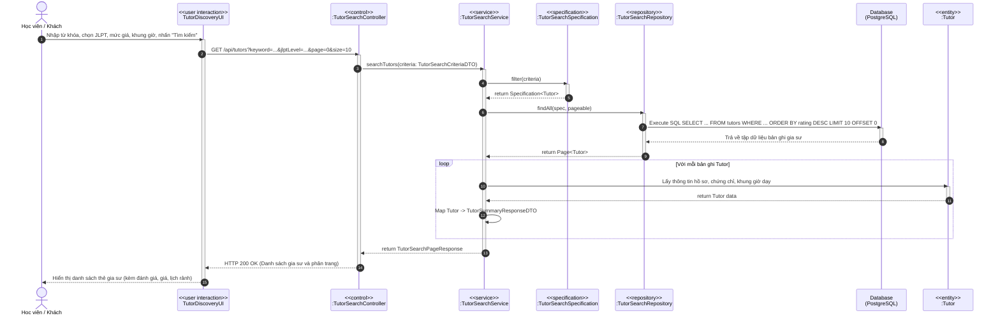
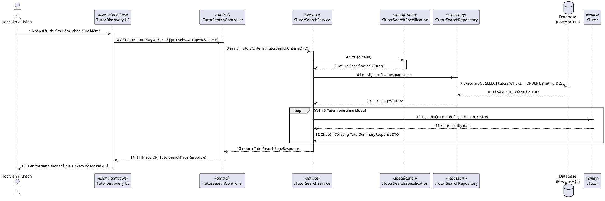
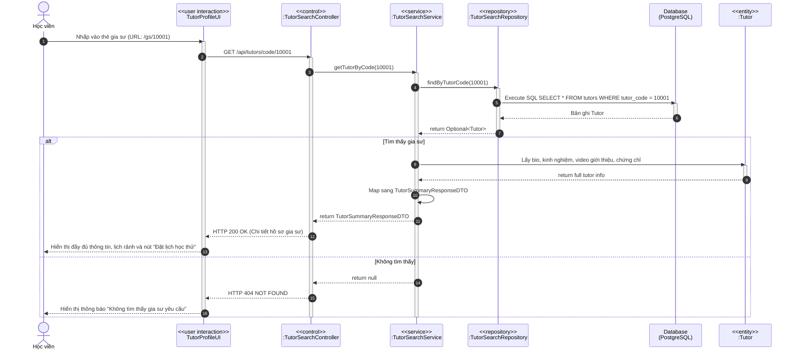
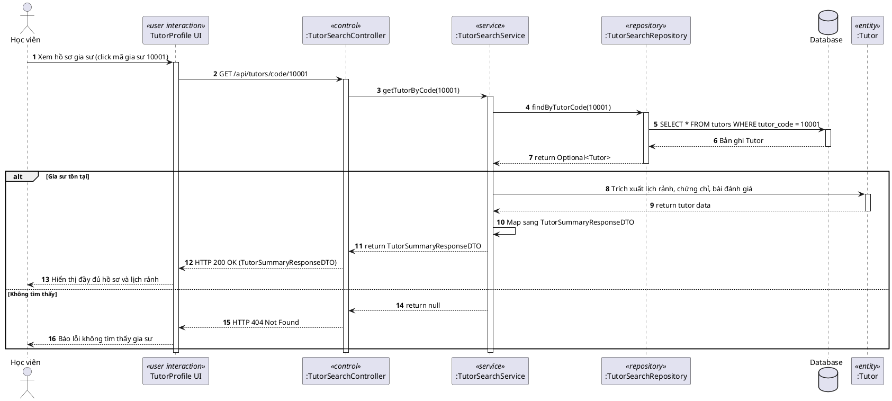
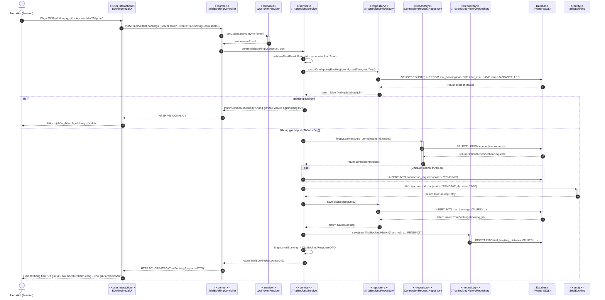
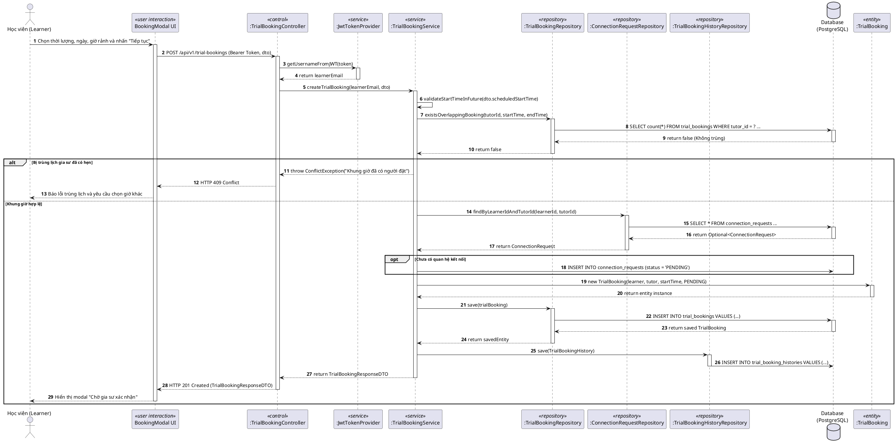
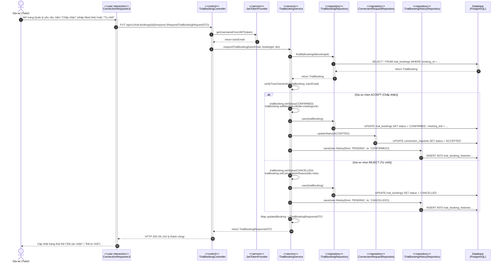
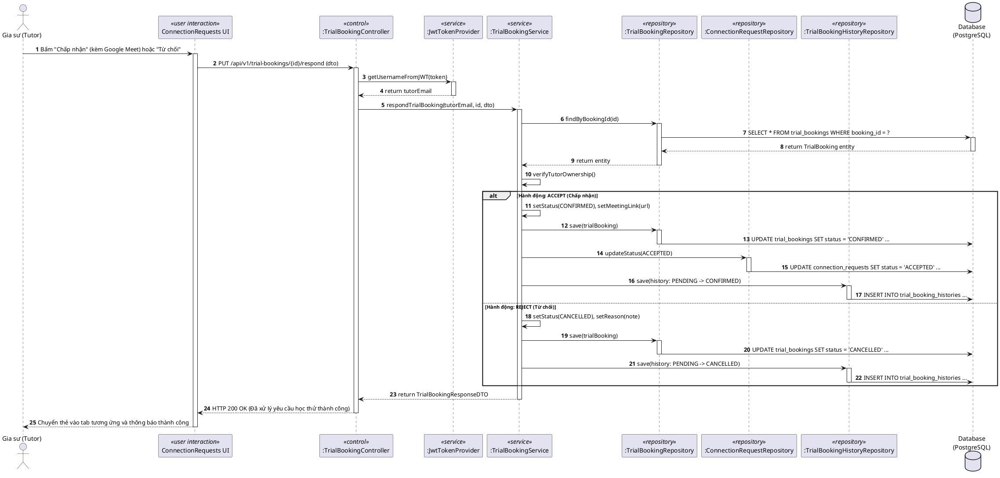
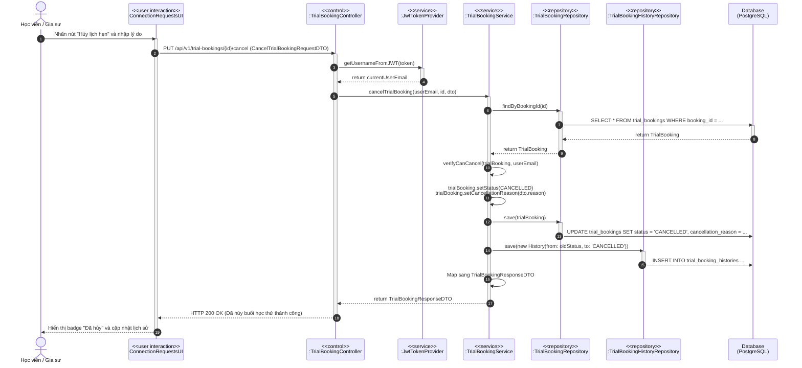
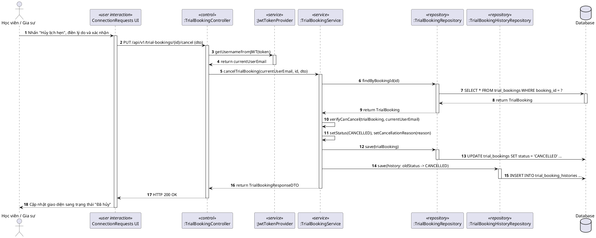

# Sequence Diagrams - Feature 4 & Feature 5 (KizunaTutor)

Tài liệu này đặc tả các biểu đồ tuần tự (Sequence Diagram) cho các luồng nghiệp vụ cốt lõi của **Feature 4 (Tìm kiếm và khám phá gia sư - FE-04)** và **Feature 5 (Đăng ký học thử 1-1 và kết nối - FE-05)** theo đúng chuẩn mẫu (template) gồm các stereotype phân tầng:
- `<<user interaction>>` Tầng giao diện người dùng (UI)
- `<<control>>` Tầng điều khiển (REST Controller)
- `<<service>>` Tầng nghiệp vụ (Service Layer & Cross-cutting)
- `<<repository>>` Tầng truy xuất dữ liệu (Data Access / Repository)
- `Database` Cơ sở dữ liệu (PostgreSQL)
- `<<entity>>` Đối tượng miền thực thể (Domain Entity)

---

## Danh mục các Sequence Diagram chính

1. **Sequence 1 (FE-04)**: Tìm kiếm và lọc danh sách gia sư (`Search Tutors Sequence`)
2. **Sequence 2 (FE-04)**: Xem chi tiết hồ sơ gia sư (`View Tutor Profile Sequence`)
3. **Sequence 3 (FE-05)**: Học viên đăng ký lịch học thử 1-1 (`Create Trial Booking Sequence`)
4. **Sequence 4 (FE-05)**: Gia sư tiếp nhận và phản hồi yêu cầu học thử (`Respond Trial Booking Sequence`)
5. **Sequence 5 (FE-05)**: Hủy buổi học thử trước giờ học (`Cancel Trial Booking Sequence`)

---

## 1. Sequence 1: Tìm kiếm & Lọc danh sách gia sư (FE-04)

### 1.1. Sơ đồ Mermaid

### 1.2. Mã nguồn PlantUML (Sao chép vào PlantUML / Word)

---

## 2. Sequence 2: Xem chi tiết hồ sơ gia sư (FE-04)

### 2.1. Sơ đồ Mermaid

### 2.2. Mã nguồn PlantUML

---

## 3. Sequence 3: Học viên đăng ký học thử 1-1 (FE-05) - Trọng tâm

### 3.1. Sơ đồ Mermaid

### 3.2. Mã nguồn PlantUML

---

## 4. Sequence 4: Gia sư tiếp nhận và phản hồi yêu cầu học thử (FE-05)

### 4.1. Sơ đồ Mermaid

### 4.2. Mã nguồn PlantUML

---

## 5. Sequence 5: Học viên / Gia sư hủy buổi học thử (FE-05)

### 5.1. Sơ đồ Mermaid

### 5.2. Mã nguồn PlantUML

