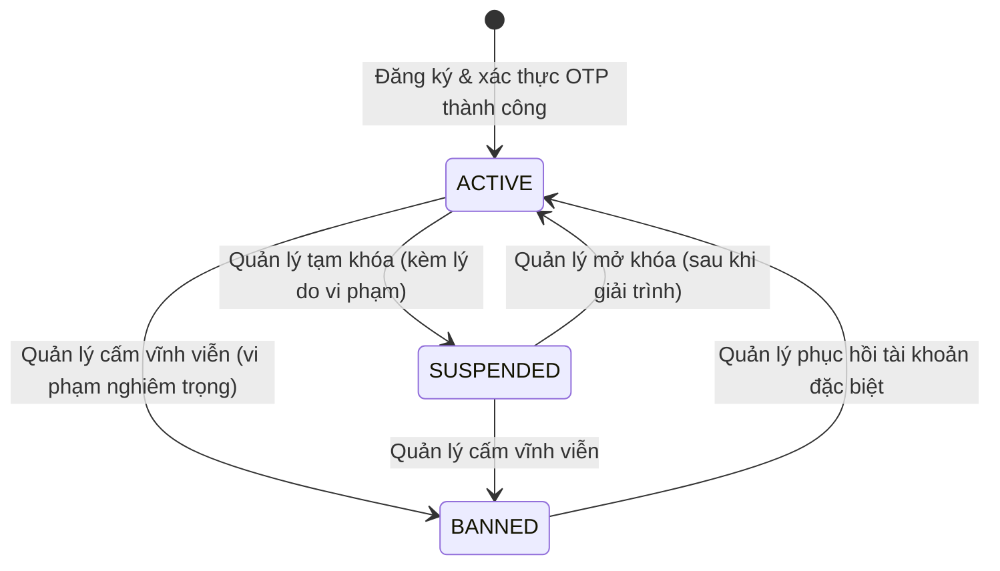

# Mô hình dữ liệu: FE-02 — Quản lý hồ sơ Học viên & Gia sư (Data Model)

**Tính năng**: `002-profile-management`  
**Ngày cập nhật**: 2026-11-10  
**Tài liệu tham chiếu**: [spec.md](spec.md), [research.md](research.md), `DatabasePgAdmin4.txt`.

---

## 1. Sơ đồ thực thể & Mối quan hệ (Entity Relationships)

```mermaid
erDiagram
    users ||--o| learners : "1-1 (ROLE_LEARNER)"
    users ||--o| tutors : "1-1 (ROLE_TUTOR)"
    roles ||--o{ users : "1-n (phân quyền)"

    users {
        UUID user_id PK
        UUID role_id FK
        VARCHAR email "UK - Bất biến trong profile"
        VARCHAR password_hash
        VARCHAR full_name "Họ và tên người dùng"
        VARCHAR phone "Số điện thoại liên lạc"
        VARCHAR avatar_url "Đường dẫn ảnh đại diện"
        ENUM account_status "ACTIVE, SUSPENDED, BANNED"
        BOOLEAN must_change_password
        TIMESTAMPTZ created_at
        TIMESTAMPTZ updated_at
        TIMESTAMPTZ deleted_at
    }

    learners {
        UUID learner_id PK
        UUID user_id FK "UK - Liên kết 1-1"
        VARCHAR current_level "BEGINNER, N5..N1"
        VARCHAR target_level "N5..N1"
        TEXT learning_goals "Nguyện vọng và mục tiêu học tập"
        TIMESTAMPTZ updated_at
    }

    tutors {
        UUID tutor_id PK
        BIGINT tutor_code "UK - Mã gia sư tự tăng"
        UUID user_id FK "UK - Liên kết 1-1"
        VARCHAR headline "Danh hiệu / Tiêu đề giới thiệu"
        TEXT bio "Tiểu sử giới thiệu chuyên môn"
        SMALLINT experience_years "Số năm kinh nghiệm"
        NUMERIC hourly_rate "Học phí đề xuất theo giờ"
        VARCHAR highest_jlpt_level "Cấp độ JLPT cao nhất (N5..N1)"
        NUMERIC avg_rating "Điểm đánh giá trung bình"
        INTEGER total_reviews "Tổng lượt đánh giá"
        VARCHAR phone "Đồng bộ từ users"
        VARCHAR address "Tỉnh/Thành - Địa chỉ chi tiết"
        ENUM verification_status "Trạng thái xác minh"
        ENUM membership_status "Trạng thái gói hội viên"
        TIMESTAMPTZ updated_at
    }
```



---

## 2. Đặc tả cấu trúc DTOs (Data Transfer Objects)

### 2.1. Nhóm DTO Học viên (Learner Profile)

#### `LearnerProfileResponseDto` (Trả về cho Client)
```json
{
  "userId": "e8a947a1-8d02-45e6-b631-f925b6a3e110",
  "email": "learner@kizuna.vn",
  "fullName": "Nguyễn Văn An",
  "phone": "0987654321",
  "avatarUrl": "https://images.unsplash.com/photo-1534528741775-53994a69daeb",
  "currentLevel": "BEGINNER",
  "targetLevel": "N3",
  "learningGoals": "Luyện thi JLPT N3 và nâng cao kỹ năng giao tiếp tiếng Nhật trong công việc.",
  "createdAt": "2026-11-01T10:00:00Z",
  "updatedAt": "2026-11-10T15:30:00Z"
}
```

#### `UpdateLearnerProfileRequest` (Client gửi lên)
| Trường | Kiểu dữ liệu | Ràng buộc | Mô tả |
| :--- | :--- | :--- | :--- |
| `fullName` | `String` | `@NotBlank`, `@Size(max = 100)` | Họ và tên học viên |
| `phone` | `String` | `@Pattern(regexp = "^(0|\\+84)[0-9]{9}$")` | Số điện thoại di động hợp lệ |
| `avatarUrl` | `String` | `@Size(max = 500)` (tùy chọn) | Đường dẫn ảnh đại diện |
| `currentLevel`| `String` | Một trong các giá trị: `BEGINNER`, `N5`, `N4`, `N3`, `N2`, `N1` | Trình độ hiện tại |
| `targetLevel` | `String` | Một trong các giá trị: `N5`, `N4`, `N3`, `N2`, `N1` | Trình độ mục tiêu |
| `learningGoals`| `String` | `@Size(max = 2000)` (tùy chọn) | Mục tiêu và nguyện vọng học tập |

---

### 2.2. Nhóm DTO Gia sư (Tutor Profile)

#### `TutorProfileDetailDto` (Trả về cho Client)
```json
{
  "userId": "a2b3c4d5-1111-2222-3333-444455556666",
  "tutorId": "f1e2d3c4-9999-8888-7777-666655554444",
  "tutorCode": 10001,
  "email": "tutor.ha@kizuna.vn",
  "fullName": "Nguyễn Thu Hà",
  "phone": "0912345678",
  "avatarUrl": "https://images.unsplash.com/photo-1544005313-94ddf0286df2",
  "headline": "Gia sư tiếng Nhật giao tiếp và luyện thi JLPT",
  "bio": "Cử nhân ngành Nhật Bản học, có 3 năm kinh nghiệm giảng dạy tiếng Nhật cho người đi làm.",
  "experienceYears": 3,
  "hourlyRate": 250000.00,
  "highestJlptLevel": "N2",
  "province": "Hà Nội",
  "addressDetail": "Cầu Giấy",
  "fullAddress": "Hà Nội - Cầu Giấy",
  "avgRating": 5.0,
  "totalReviews": 0,
  "verificationStatus": "APPROVED",
  "isOwner": true
}
```

#### `UpdateTutorProfileRequest` (Client gửi lên)
| Trường | Kiểu dữ liệu | Ràng buộc | Mô tả |
| :--- | :--- | :--- | :--- |
| `fullName` | `String` | `@NotBlank`, `@Size(max = 100)` | Họ và tên gia sư |
| `phone` | `String` | `@Pattern(regexp = "^(0|\\+84)[0-9]{9}$")` | Số điện thoại liên hệ |
| `avatarUrl` | `String` | `@Size(max = 500)` (tùy chọn) | Đường dẫn ảnh đại diện |
| `headline` | `String` | `@NotBlank`, `@Size(max = 200)` | Tiêu đề giới thiệu ngắn |
| `bio` | `String` | `@NotBlank`, `@Size(max = 4000)` | Tiểu sử giới thiệu chuyên môn |
| `experienceYears` | `Short` | `@Min(0)`, `@Max(50)` | Số năm kinh nghiệm |
| `hourlyRate` | `BigDecimal` | `@Min(0)` (0 đ là "Thỏa thuận") | Mức học phí đề xuất mỗi giờ |
| `highestJlptLevel` | `String` | Một trong các giá trị: `N5`, `N4`, `N3`, `N2`, `N1` | Trình độ JLPT cao nhất |
| `province` | `String` | `@NotBlank`, khớp danh mục Tỉnh/Thành | Tỉnh / Thành phố giảng dạy |
| `addressDetail` | `String` | `@Size(max = 150)` (tùy chọn) | Quận/Huyện, khu vực chi tiết |

---

### 2.3. Nhóm DTO Quản lý người dùng (Manager User Management)

#### `UserProfileListItemDto`
```json
{
  "userId": "e8a947a1-8d02-45e6-b631-f925b6a3e110",
  "email": "learner@kizuna.vn",
  "fullName": "Nguyễn Văn An",
  "phone": "0987654321",
  "avatarUrl": "https://images.unsplash.com/photo-1534528741775-53994a69daeb",
  "role": "ROLE_LEARNER",
  "roleBadge": "Học viên",
  "accountStatus": "ACTIVE",
  "createdAt": "2026-11-01T10:00:00Z"
}
```

#### `UpdateUserStatusRequest`
| Trường | Kiểu dữ liệu | Ràng buộc | Mô tả |
| :--- | :--- | :--- | :--- |
| `status` | `UserAccountStatus` | `@NotNull` | `ACTIVE`, `SUSPENDED`, hoặc `BANNED` |
| `reason` | `String` | `@NotBlank`, `@Size(min = 5, max = 500)` | Lý do thay đổi trạng thái (bắt buộc) |

#### `AvatarUploadResponseDto`
```json
{
  "avatarUrl": "/api/profile/avatar/a8b9c1d2-avatar.png",
  "fileName": "a8b9c1d2-avatar.png",
  "size": 245600
}
```

---

## 3. Vòng đời & Quy tắc chuyển trạng thái tài khoản (`account_status`)



- Khi tài khoản chuyển sang `SUSPENDED` hoặc `BANNED`: Hệ thống từ chối mọi yêu cầu đăng nhập tiếp theo và lập tức từ chối các request mang Token của tài khoản này ở tầng `JwtFilter` (HTTP 403 Forbidden với thông báo: *"Tài khoản của bạn hiện đang bị tạm khóa/cấm. Vui lòng liên hệ bộ phận hỗ trợ.*").

