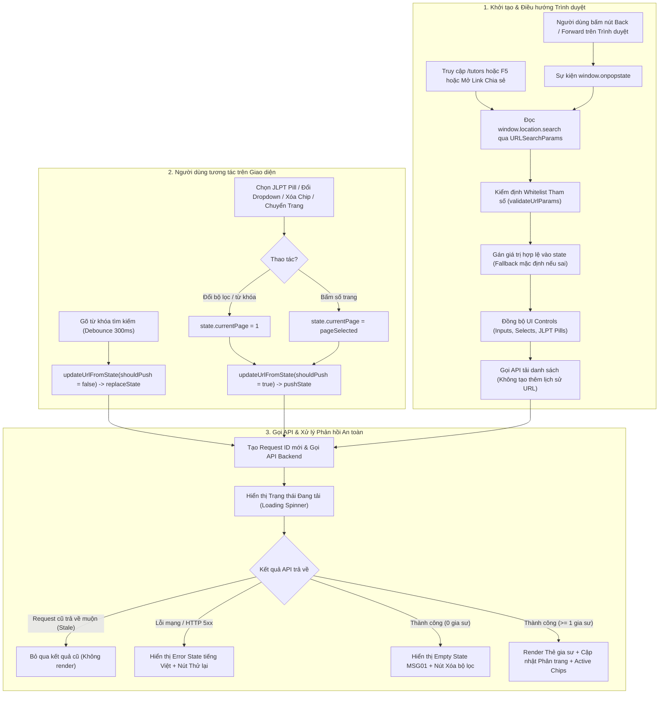

# Implementation Plan: FE-04 — Bộ Lọc Tìm Kiếm, Đồng Bộ URL (URL Synchronization) & Dynamic Routing

**Branch**: `haipt` | **Date**: 2026-11-01 | **Spec**: [spec.md](spec.md) | **Research**: [research.md](research.md) | **Data Model**: [data-model.md](data-model.md) | **Contract**: [contracts/tutor-search-contract.md](contracts/tutor-search-contract.md)

---

## 1. Tóm tắt kế hoạch (Summary)

Kế hoạch này hoàn thiện kiến trúc tìm kiếm, lọc đa tiêu chí, phân trang và xử lý dữ liệu cho phân hệ Khám phá gia sư tiếng Nhật (`tutor-discovery`), kết hợp chặt chẽ cơ chế **Đồng bộ trạng thái với URL hai chiều (Two-Way URL Synchronization)**, **Kiểm định tham số an toàn (Parameter Validation)** và **Định tuyến động (Dynamic Routing)** trên nền tảng Frontend Vanilla JavaScript (ES6+ Module), Node.js Web Server và Backend Java Spring Boot.

### Mục tiêu cốt lõi:
1. **Lọc tìm kiếm đa chiều & Phân trang (Multi-Criteria Filtering & Pagination)**:
   - 5 tiêu chí nghiệp vụ kết hợp (AND logic): Mục tiêu học tập, Trình độ JLPT (N1–N5), Hình thức học (Online/Offline/Hybrid), Mức học phí/giờ, Lịch rảnh.
   - Tìm kiếm từ khóa theo tên, kỹ năng, chuyên môn với cơ chế Debounce 300ms.
   - Sắp xếp linh hoạt (Đánh giá cao nhất, Giá tăng/giảm dần, Kinh nghiệm).
   - Quản lý phân trang hai chiều: Frontend (1-indexed) ↔ Backend Pageable (0-indexed).
   - Chip bộ lọc đang áp dụng (Active Filter Chips) cho phép xóa từng tiêu chí độc lập hoặc xóa tất cả qua nút *"Đặt lại bộ lọc"*.
   - Khả năng phục hồi giao diện: Quản trị 4 trạng thái (Loading, Success, Empty MSG01, Error thân thiện kèm nút Thử lại) và chống ghi đè kết quả bất đồng bộ cũ (Stale Request Handling).
2. **Đồng bộ URL theo lựa chọn (Two-Way URL Synchronization)**:
   - **State ➔ URL**: Khi người dùng thay đổi bộ lọc hoặc chuyển trang, URL cập nhật Query Parameters qua `history.pushState` (tạo bước lịch sử); khi gõ từ khóa, URL cập nhật qua `history.replaceState` (không làm rác lịch sử duyệt web).
   - **URL ➔ State**: Khi tải lại trang (`F5`), mở link chia sẻ, hoặc điều hướng Back/Forward (`popstate`), hệ thống kiểm định tham số (Whitelist Validation), khôi phục trạng thái các điều khiển UI và tải đúng dữ liệu mà không gây vòng lặp vô tận (Zero Reload, Zero State Loop).
   - **Làm sạch URL (Clean URL)**: Tự động loại bỏ các tham số mặc định (`jlpt=all`, `sort=rating`, `page=1`, chuỗi rỗng) để giữ URL thanh lịch và tối ưu SEO.
3. **Kết hợp Dynamic Routing (Định tuyến động)**:
   - Route tìm kiếm ngắn gọn: `/tutors` và `/tutors/` ánh xạ trực tiếp đến trang tìm kiếm với tài nguyên tĩnh được tải an toàn qua đường dẫn tuyệt đối.
   - Tái sử dụng route hồ sơ gia sư: `/gs/:tutorCode` được liên kết trực tiếp từ mỗi thẻ gia sư trong kết quả tìm kiếm.
   - Deep Linking từ Trang chủ: Các nút tìm kiếm nhanh từ `home.html` điều hướng chuẩn xác sang `/tutors` kèm tham số lọc tương ứng.

---

## 2. Bối cảnh kỹ thuật (Technical Context)

- **Frontend Core**: HTML5, CSS3, Tailwind CSS CDN, JavaScript ES6+ thuần (Module ES, không sử dụng framework React/Vue hay thư viện định tuyến bên ngoài).
- **History Management**: Web History API (`window.history.pushState`, `window.history.replaceState`, sự kiện `popstate`, đối tượng `URLSearchParams`).
- **Web Dev Server**: Node.js native (`frontend/server.js`) chạy cổng 3000 hỗ trợ route tĩnh và route động alias (`/tutors`, `/gs/:tutorCode`).
- **Backend API**: Spring Boot (`http://localhost:8085/api/tutors/search`) kết nối cơ sở dữ liệu PostgreSQL Supabase.
- **Ràng buộc UI & Ngôn ngữ**: Tuân thủ tuyệt đối `AGENTS.md` và `DESIGN.md` (100% tiếng Việt tự nhiên, không lộ mã enum/HTTP thô, không viết hoa toàn bộ, giữ màu thương hiệu Aizome `#006194`, Navy `#0F2545`, Washi `#FCFBF7`).

---

## 3. Constitution Check (Kiểm tra Quy định Hiến pháp Dự án)

*Đánh giá dự kiến tuân thủ 5 nguyên tắc bất biến của KizunaTutor trước giai đoạn triển khai:*

| Nguyên tắc | Đánh giá thiết kế | Bằng chứng đối chiếu & Kế hoạch xác minh |
| :--- | :--- | :--- |
| **I. Tiếng Việt, không lộ kỹ thuật** | **Đạt về mặt thiết kế** | Toàn bộ 4 trạng thái giao diện (Đang tải, Danh sách thành công, Màn hình rỗng MSG01, Thông báo lỗi kết nối có nút "Thử lại") đều dùng tiếng Việt tự nhiên; không lộ tên biến hay mã HTTP 500/404. Cần xác minh hiển thị thực tế trên UI. |
| **II. Dữ liệu thật & Empty State** | **Đạt về mặt thiết kế** | Dữ liệu nạp 100% từ API `/api/tutors/search`. Khi không có kết quả, hiển thị Empty State chuẩn và nút "Xóa tất cả bộ lọc". Tuyệt đối không chèn mảng giả lập vào logic chạy thật. |
| **III. Giữ kiến trúc & quy ước** | **Đạt về mặt thiết kế** | Giữ trọn kiến trúc Vanilla JS + Spring Boot hiện tại; không cài đặt thêm package ngoài. Bổ sung tham số phân trang và lọc tương thích hoàn toàn với DTO Backend đã có. |
| **IV. Thiết kế nhất quán theo phân hệ** | **Đạt về mặt thiết kế** | Giữ nguyên bộ nhận diện: bo góc, bóng khối cứng nhẹ, bảng màu Aizome, Washi, Navy và font chữ `Plus Jakarta Sans`. |
| **V. Phạm vi & kiểm chứng được** | **Cần xác minh qua kiểm thử** | Kế hoạch giới hạn chặt chẽ trong phân hệ FE-04. Thiết lập 18 kịch bản kiểm thử tích hợp chi tiết tại Phase 5 để nghiệm thu trước khi bàn giao. |

---

## 4. Kiến trúc luồng đồng bộ URL (Architecture Diagram)

---

## 5. Kế hoạch triển khai chi tiết (Implementation Phases)

### Giai đoạn 1: Chuẩn hóa Route trên Máy chủ Web (`frontend/server.js`)
- [ ] **T1.1**: Cấu hình alias định tuyến cho `/tutors` và `/tutors/` trong `frontend/server.js` để phục vụ trực tiếp file `frontend/pages/tutor-discovery/index.html`.
- [ ] **T1.2**: Đảm bảo toàn bộ tài nguyên tĩnh (`.js`, `.css`, fonts, images) khi truy cập từ route ngắn `/tutors` không bị lỗi 404 hoặc sai MIME type; rà soát đường dẫn tài nguyên sang đường dẫn tuyệt đối.
- [ ] **T1.3**: Xác nhận tương thích và giữ nguyên route động `/gs/:tutorCode` đã triển khai từ trước cho hồ sơ gia sư (đóng vai trò route đích khi người dùng nhấp vào từng thẻ gia sư).
- [ ] **T1.4**: Rà soát và chuẩn hóa thẻ script trong `frontend/pages/tutor-discovery/index.html` sang đường dẫn tuyệt đối `/pages/tutor-discovery/tutor-discovery.js`.

### Giai đoạn 2: Hiện thực Module Đồng bộ URL Hai Chiều & Kiểm Định Tham Số
- [ ] **T2.1**: Xây dựng module kiểm định tham số URL (`validateUrlParams`):
  - Định nghĩa Whitelist giá trị hợp lệ cho từng tham số:
    - `jlpt`: `['N1', 'N2', 'N3', 'N4', 'N5', 'all']`
    - `goal`: `['kaiwa', 'jlpt', 'business', 'it']`
    - `format`: `['online', 'offline', 'hybrid']`
    - `price`: `['150-250', '250-400', '400-600']`
    - `schedule`: `['today', 'weekend', 'evening']`
    - `sort`: `['rating', 'price_asc', 'price_desc', 'exp']`
    - `page`: Số nguyên `>= 1`
  - Nếu gặp giá trị không hợp lệ: bỏ qua, khôi phục về giá trị mặc định an toàn, không để ứng dụng phát sinh lỗi.
- [ ] **T2.2**: Xây dựng hàm khôi phục trạng thái từ URL (`syncStateFromUrl`):
  - Đọc `window.location.search` qua `URLSearchParams`.
  - Khôi phục chính xác toàn bộ trường của `state`: `keyword`, `jlptLevel`, `goal`, `format`, `priceRange`, `schedule`, `sortBy`, `currentPage`.
  - Đồng bộ giá trị lên tất cả các phần tử UI Controls: gán `value` cho ô tìm kiếm, gán giá trị các dropdown, kích hoạt class active cho pill JLPT tương ứng.
  - Áp dụng khi tải trang lần đầu, khi F5 và khi mở URL chia sẻ.
- [ ] **T2.3**: Xây dựng hàm cập nhật URL từ State (`updateUrlFromState(shouldPush = true)`):
  - Chuyển đổi đối tượng `state` thành `URLSearchParams`.
  - **Làm sạch URL (Clean URL)**: Tự động loại bỏ các tham số mặc định (`jlpt === 'all'`, `sortBy === 'rating'`, `currentPage === 1`, chuỗi rỗng) để giữ thanh địa chỉ ngắn gọn.
  - Sử dụng `window.history.pushState` khi click chọn bộ lọc hoặc chuyển trang.
  - Sử dụng `window.history.replaceState` khi cập nhật từ ô tìm kiếm (tránh spam lịch sử duyệt web).
  - Sử dụng cờ kiểm soát nội bộ (`isPopStateHandling`) để ngăn chặn vòng lặp `State ➔ URL ➔ State`.
- [ ] **T2.4**: Lắng nghe và xử lý sự kiện điều hướng trình duyệt (`window.addEventListener('popstate')`):
  - Bóc tách URL mới khi người dùng bấm Back / Forward.
  - Gọi `syncStateFromUrl()` và gọi hàm tải dữ liệu với cờ `shouldUpdateUrl = false` để không ghi đè lại URL đang điều hướng.

### Giai đoạn 3: Bộ Lọc, Tìm Kiếm, Phân Trang, Active Chips & Xử Lý API
- [ ] **T3.1**: Tích hợp Debounce 300ms cho ô tìm kiếm từ khóa:
  - Khi người dùng gõ phím: đợi 300ms không có thao tác mới, cập nhật `state.keyword`, reset `state.currentPage = 1`.
  - Cập nhật URL qua `replaceState` và gọi API tìm kiếm.
- [ ] **T3.2**: Xử lý sự kiện tương tác bộ lọc Dropdown và Chip JLPT:
  - Khi người dùng thay đổi Mục tiêu học tập, Hình thức học, Khoảng giá, Lịch rảnh, Sắp xếp hoặc chọn cấp độ JLPT: cập nhật `state`, reset `state.currentPage = 1`.
  - Cập nhật URL qua `pushState` và gọi API tìm kiếm.
- [ ] **T3.3**: Hiện thực khối Chip bộ lọc đang áp dụng (Active Filter Chips) và Đặt lại:
  - Hiển thị danh sách các chip đang áp dụng với nhãn tiếng Việt rõ ràng.
  - Khi bấm nút `×` trên từng chip: chỉ xóa tiêu chí tương ứng, giữ nguyên các tiêu chí còn lại, đưa `state.currentPage = 1`, cập nhật URL và tải lại danh sách.
  - Nút *"Đặt lại bộ lọc"* (`#reset-filter-btn`) và nút *"Xóa tất cả bộ lọc"* (`#empty-reset-btn`): đưa toàn bộ trạng thái về mặc định, xóa hết query params trên URL và tải lại toàn bộ gia sư khả dụng.
- [ ] **T3.4**: Hiện thực phân trang (Pagination) hai chiều Frontend ↔ Backend:
  - Quản lý `currentPage` (1-indexed trên UI) và chuyển đổi thành `page = currentPage - 1` (0-indexed khi gửi lên Backend).
  - Nhận phản hồi `TutorSearchPageResponse` (`pageNumber`, `pageSize`, `totalElements`, `totalPages`, `last`):
    - Cập nhật dải hiển thị "Hiển thị X - Y trong tổng số Z gia sư".
    - Render danh sách nút số trang và nút Trước / Sau; vô hiệu hóa nút tương ứng khi ở trang đầu hoặc trang cuối.
  - Khi bấm chuyển trang: cập nhật `state.currentPage`, gọi `pushState` cập nhật URL, cuộn màn hình mượt mà lên đầu danh sách gia sư và gọi API.
  - Xử lý tình huống biên: Nếu `currentPage > totalPages` (do thay đổi bộ lọc làm giảm số trang), tự động điều chỉnh về trang 1 và chuẩn hóa lại URL.
- [ ] **T3.5**: Ánh xạ chuẩn xác Khoảng học phí (Price Range Mapping) giữa Frontend và Backend:
  - Frontend `'150-250'` ➔ Backend `minPrice = 150000`, `maxPrice = 250000` (VNĐ).
  - Frontend `'250-400'` ➔ Backend `minPrice = 250000`, `maxPrice = 400000` (VNĐ).
  - Frontend `'400-600'` (hoặc trên 400k) ➔ Backend `minPrice = 400000`, `maxPrice = null` (không giới hạn trần).
  - Rà soát điều kiện so sánh tại các điểm biên (`>=` và `<=`), đảm bảo tính nhất quán giữa UI và tiêu chí Specification trong Backend.
- [ ] **T3.6**: Ánh xạ đầy đủ DTO Request và Response giữa Frontend và Backend:
  - Đảm bảo gọi API qua module `API.tutors.search(criteria)` với đủ các trường: `keyword`, `jlptLevel`, `goal`, `format`, `minPrice`, `maxPrice`, `schedule`, `sortBy`, `page`, `size`.
  - Xử lý trích xuất dữ liệu thẻ gia sư từ `TutorSummaryResponseDTO`: tạo liên kết xem chi tiết hồ sơ dạng `/gs/${tutor.tutorCode}`.
- [ ] **T3.7**: Quản trị 4 trạng thái giao diện và Cơ chế chống Race Condition (Stale Request Prevention):
  - Hiện thực đủ 4 trạng thái:
    1. **Đang tải (Loading)**: Vòng quay spinner kèm dòng chữ *"Đang tải danh sách gia sư từ máy chủ..."*.
    2. **Thành công (Success)**: Render danh sách thẻ gia sư, thanh phân trang và số lượng kết quả.
    3. **Rỗng (Empty - MSG01)**: Khối thông báo lịch sự *"Không tìm thấy gia sư phù hợp với tiêu chí tìm kiếm..."* kèm nút bấm *"Xóa tất cả bộ lọc"*.
    4. **Lỗi (Error)**: Thông báo lỗi kết nối bằng tiếng Việt tự nhiên kèm nút *"Thử lại"* cho phép kích hoạt tải lại dữ liệu mà không làm treo giao diện.
  - Cơ chế chống Race Condition: Áp dụng Request Counter tăng dần (hoặc `AbortController`) để đảm bảo nếu người dùng thao tác liên tục, kết quả của request gửi trước trả về muộn sẽ bị loại bỏ và không bao giờ ghi đè kết quả của request mới nhất.

### Giai đoạn 4: Tích hợp Deep Linking từ Trang Chủ (`frontend/pages/home/`)
- [ ] **T4.1**: Cập nhật các liên kết điều hướng từ Header và nút "Tìm gia sư ngay" trên Trang chủ trỏ trực tiếp đến route ngắn `/tutors`.
- [ ] **T4.2**: Kết nối khối Quick Filter tại Hero Section của Trang chủ:
  - Khi người dùng chọn Mục tiêu, Hình thức hoặc Học phí trên Trang chủ và bấm "Tìm kiếm gia sư", tạo URL với query parameters tương ứng (ví dụ `/tutors?goal=kaiwa&format=online`) và điều hướng mượt mà sang trang tìm kiếm.
- [ ] **T4.3**: Kết nối các chip cấp độ JLPT (N1–N5) trên Trang chủ:
  - Bấm vào chip cấp độ trên Trang chủ sẽ điều hướng thẳng sang `/tutors?jlpt=N1`, `/tutors?jlpt=N2`... và trang tìm kiếm tự động kích hoạt lọc tương ứng.
- [ ] **T4.4**: Đảm bảo các liên kết "Xem hồ sơ chi tiết" của khối Gia sư tiêu biểu trên Trang chủ dẫn đúng đến dynamic route `/gs/${tutor.tutorCode}`.

### Giai đoạn 5: Kiểm Thử Tích Hợp và Nghiệm Thu Toàn Diện
Xác định 18 kịch bản kiểm thử tích hợp (Integration Test Scenarios) với đầy đủ điều kiện đầu vào, thao tác và kết quả kỳ vọng:

- [ ] **T5.1 (Kịch bản 1 - Lọc đơn JLPT)**:
  - *Đầu vào*: Đang ở `/tutors`.
  - *Thao tác*: Bấm vào pill `N2`.
  - *Kỳ vọng*: URL chuyển thành `/tutors?jlpt=N2`; pill N2 có class active; danh sách chỉ hiển thị gia sư đạt N2.
- [ ] **T5.2 (Kịch bản 2 - Lọc kết hợp nhiều tiêu chí)**:
  - *Đầu vào*: Đang ở `/tutors?jlpt=N2`.
  - *Thao tác*: Chọn Mục tiêu: "Luyện giao tiếp", Hình thức: "Học Online", Sắp xếp: "Mức học phí: Thấp đến cao".
  - *Kỳ vọng*: URL chuyển thành `/tutors?jlpt=N2&goal=kaiwa&format=online&sort=price_asc`; danh sách lọc kết hợp đúng các tiêu chí và sắp xếp tăng dần theo giá.
- [ ] **T5.3 (Kịch bản 3 - Nhập từ khóa với Debounce 300ms)**:
  - *Đầu vào*: Đang ở `/tutors`.
  - *Thao tác*: Gõ "Kenji" vào ô tìm kiếm.
  - *Kỳ vọng*: Không gửi request khi đang gõ; sau 300ms ngừng gõ, URL cập nhật `?q=Kenji` qua `replaceState`; chỉ có 1 bước lịch sử trong History; danh sách hiển thị gia sư có tên hoặc chuyên môn chứa "Kenji".
- [ ] **T5.4 (Kịch bản 4 - Tải lại trang giữ nguyên trạng thái F5)**:
  - *Đầu vào*: Đang ở `/tutors?jlpt=N1&goal=business`.
  - *Thao tác*: Nhấn F5 (Reload).
  - *Kỳ vọng*: Trang nạp lại xong, pill N1 vẫn được active; dropdown Mục tiêu vẫn chọn "Tiếng Nhật thương mại"; danh sách hiển thị đúng kết quả lọc.
- [ ] **T5.5 (Kịch bản 5 - Nút Back của trình duyệt)**:
  - *Đầu vào*: Đang ở `/tutors`, bấm chọn `N2`, sau đó chọn tiếp mức giá `150-250`.
  - *Thao tác*: Bấm nút Back trên trình duyệt.
  - *Kỳ vọng*: URL quay về `/tutors?jlpt=N2`; dropdown mức giá quay về mặc định; danh sách cập nhật lại đúng bộ lọc N2 mà không tải lại toàn trang.
- [ ] **T5.6 (Kịch bản 6 - Nút Forward của trình duyệt)**:
  - *Đầu vào*: Vừa thực hiện thao tác Back ở kịch bản T5.5.
  - *Thao tác*: Bấm nút Forward trên trình duyệt.
  - *Kỳ vọng*: URL quay lại `/tutors?jlpt=N2&price=150-250`; dropdown mức giá khôi phục lựa chọn; danh sách cập nhật đúng.
- [ ] **T5.7 (Kịch bản 7 - Xóa 1 chip Active Filter)**:
  - *Đầu vào*: Đang lọc `?jlpt=N2&goal=kaiwa`.
  - *Thao tác*: Bấm nút `×` trên chip "Luyện giao tiếp".
  - *Kỳ vọng*: Chip biến mất; URL cập nhật thành `/tutors?jlpt=N2`; pill N2 vẫn giữ nguyên; danh sách nạp lại chỉ theo điều kiện N2.
- [ ] **T5.8 (Kịch bản 8 - Đặt lại tất cả bộ lọc)**:
  - *Đầu vào*: Đang áp dụng nhiều bộ lọc phức tạp.
  - *Thao tác*: Bấm nút *"Đặt lại bộ lọc"*.
  - *Kỳ vọng*: URL quay về `/tutors`; tất cả dropdown, ô tìm kiếm và pill JLPT trở về mặc định; danh sách nạp lại toàn bộ gia sư khả dụng.
- [ ] **T5.9 (Kịch bản 9 - Chuyển trang Phân trang)**:
  - *Đầu vào*: Danh sách có nhiều hơn 1 trang kết quả.
  - *Thao tác*: Bấm vào nút trang "2".
  - *Kỳ vọng*: URL cập nhật `?page=2` qua `pushState`; danh sách chuyển sang dữ liệu trang 2; dòng thông tin hiển thị đúng khoảng bản ghi.
- [ ] **T5.10 (Kịch bản 10 - URL chứa tham số không hợp lệ / sai format)**:
  - *Đầu vào*: Mở đường dẫn giả mạo `http://localhost:3000/tutors?jlpt=N999&price=hack&page=-5`.
  - *Thao tác*: Truy cập trang.
  - *Kỳ vọng*: Module validation phát hiện giá trị sai; fallback `jlpt` về 'all', `price` về '', `page` về 1; chuẩn hóa lại URL sạch và nạp dữ liệu an toàn, không bị crash JavaScript.
- [ ] **T5.11 (Kịch bản 11 - Trạng thái rỗng MSG01)**:
  - *Đầu vào*: Nhập từ khóa không tồn tại "XYZ123456789".
  - *Thao tác*: Tìm kiếm.
  - *Kỳ vọng*: Hiển thị khối Empty State với thông điệp MSG01; thanh phân trang ẩn; nút "Xóa tất cả bộ lọc" hoạt động bình thường.
- [ ] **T5.12 (Kịch bản 12 - Trạng thái lỗi mạng / API Failure)**:
  - *Đầu vào*: Tạm dừng backend hoặc ngắt kết nối mạng.
  - *Thao tác*: Thay đổi bộ lọc.
  - *Kỳ vọng*: Không bị treo giao diện; hiển thị thông báo lỗi tiếng Việt thân thiện kèm nút *"Thử lại"*; bấm "Thử lại" khi backend mở lại thì dữ liệu nạp thành công.
- [ ] **T5.13 (Kịch bản 13 - Chống Race Condition khi thao tác liên tục)**:
  - *Đầu vào*: Đang ở mạng có độ trễ.
  - *Thao tác*: Click liên tiếp pill `N1` rồi ngay lập tức click `N2`.
  - *Kỳ vọng*: Dù response của N1 có về sau response của N2 thì giao diện vẫn chỉ hiển thị kết quả của N2; không bị giật lùi dữ liệu cũ.
- [ ] **T5.14 (Kịch bản 14 - Mở trực tiếp và F5 tại route hồ sơ `/gs/10001`)**:
  - *Đầu vào*: Route hồ sơ gia sư theo mã.
  - *Thao tác*: Truy cập `http://localhost:3000/gs/10001` và bấm F5.
  - *Kỳ vọng*: Hồ sơ gia sư Yamada Kenji hiển thị đầy đủ, không bị 404 script, không quay tròn loading vô tận.
- [ ] **T5.15 (Kịch bản 15 - Deep Linking từ Trang chủ)**:
  - *Đầu vào*: Đang ở `http://localhost:3000/pages/home/`.
  - *Thao tác*: Bấm vào nút tìm kiếm nhanh hoặc liên kết "Xem tất cả gia sư".
  - *Kỳ vọng*: Điều hướng thành công sang `/tutors` với đúng các tham số đã chọn trên Trang chủ.
- [ ] **T5.16 (Kịch bản 16 - Kiểm tra giá trị biên của các khoảng giá)**:
  - *Đầu vào*: Gia sư có học phí đúng 250.000đ và 400.000đ.
  - *Thao tác*: Lọc khoảng `150-250` và `250-400`.
  - *Kỳ vọng*: Xác minh quy tắc so sánh tại các điểm biên khớp đúng logic và hiển thị nhất quán giữa Frontend và Backend.
- [ ] **T5.17 (Kịch bản 17 - Truy cập trực tiếp route `/tutors` và `/tutors/`)**:
  - *Đầu vào*: Nhập trực tiếp URL trên trình duyệt.
  - *Thao tác*: Truy cập cả hai định dạng `http://localhost:3000/tutors` và `http://localhost:3000/tutors/`.
  - *Kỳ vọng*: Cả hai đều nạp đúng trang tìm kiếm mà không bị lỗi 404 của web server.
- [ ] **T5.18 (Kịch bản 18 - Kiểm tra không lỗi tài nguyên tĩnh trên route ngắn)**:
  - *Đầu vào*: F12 mở DevTools tab Console và Network tại `/tutors`.
  - *Thao tác*: Tải trang và tương tác bộ lọc.
  - *Kỳ vọng*: 100% file JS, CSS, Font và SVG đều trả về HTTP 200; không có lỗi 404 cho bất kỳ tài nguyên nào.
