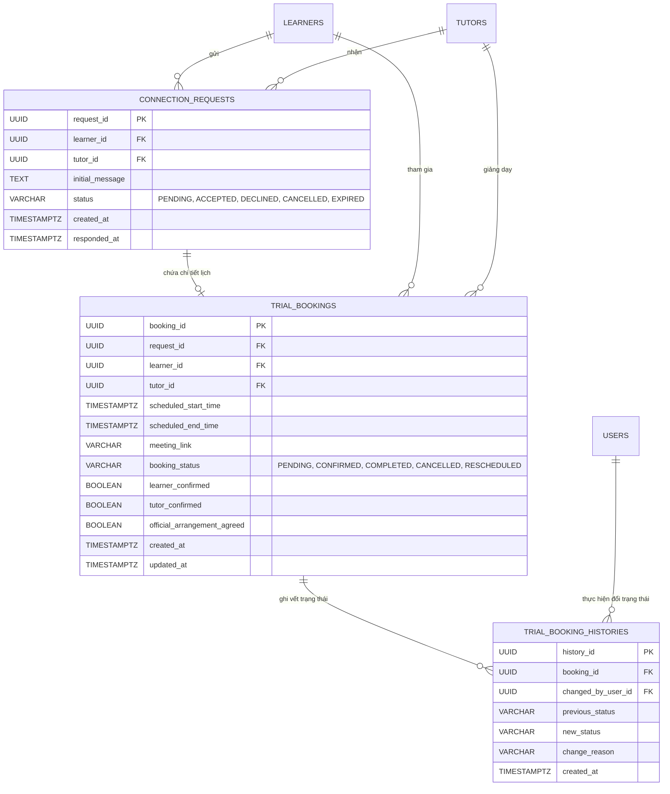
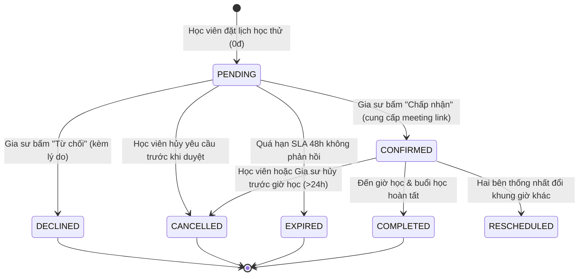

# Data Model: FE-05 — Trial Lesson Booking & Connection

**Feature**: FE-05 Trial Lesson Booking & Connection (Đăng ký học thử & Kết nối gia sư)  
**Spec Reference**: `specs/005-trial-booking-connection/spec.md`  
**Date**: 2026-11-04  

---

## 1. Sơ đồ thực thể quan hệ (ERD - Mermaid)

---

## 2. Chi tiết các thực thể (Entity Specifications)

### 2.1. Thực thể `ConnectionRequest` (`connection_requests`)

- **Mục đích**: Đại diện cho yêu cầu kết nối và lời nhắn làm quen ban đầu giữa Học viên và Gia sư.
- **Bảng CSDL**: `connection_requests`
- **Các trường**:
  - `request_id` (UUID, PK): Mã định danh duy nhất của yêu cầu kết nối.
  - `learner_id` (UUID, FK -> `learners.learner_id`, NOT NULL): Học viên gửi yêu cầu.
  - `tutor_id` (UUID, FK -> `tutors.tutor_id`, NOT NULL): Gia sư nhận yêu cầu.
  - `initial_message` (TEXT, NULLABLE): Lời nhắn ban đầu (trình độ hiện tại, mục tiêu học tập, yêu cầu hỗ trợ).
  - `status` (`connection_request_status_enum`, NOT NULL, default: `'PENDING'`):
    - `PENDING`: Đang chờ gia sư phản hồi.
    - `ACCEPTED`: Gia sư đã đồng ý kết nối.
    - `DECLINED`: Gia sư từ chối kết nối.
    - `CANCELLED`: Học viên đã hủy yêu cầu.
    - `EXPIRED`: Yêu cầu bị hết hạn do quá thời gian SLA không được xử lý.
  - `created_at` (TIMESTAMPTZ, NOT NULL): Thời điểm gửi yêu cầu.
  - `responded_at` (TIMESTAMPTZ, NULLABLE): Thời điểm gia sư phản hồi.

---

### 2.2. Thực thể `TrialBooking` (`trial_bookings`)

- **Mục đích**: Đại diện cho phiên học thử cụ thể với thời gian chốt lịch, hình thức học và liên kết phòng học.
- **Bảng CSDL**: `trial_bookings`
- **Các trường**:
  - `booking_id` (UUID, PK): Mã định danh buổi học thử.
  - `request_id` (UUID, FK -> `connection_requests.request_id`, NULLABLE): Tham chiếu đến yêu cầu kết nối gốc.
  - `learner_id` (UUID, FK -> `learners.learner_id`, NOT NULL): Học viên tham gia buổi học.
  - `tutor_id` (UUID, FK -> `tutors.tutor_id`, NOT NULL): Gia sư giảng dạy buổi học.
  - `scheduled_start_time` (TIMESTAMPTZ, NOT NULL): Thời gian bắt đầu buổi học.
  - `scheduled_end_time` (TIMESTAMPTZ, NOT NULL): Thời gian kết thúc buổi học (bắt buộc > `scheduled_start_time`).
  - `meeting_link` (VARCHAR(500), NULLABLE): Đường link phòng học online (Google Meet, Zoom) hoặc địa chỉ học trực tiếp (Offline).
  - `booking_status` (`trial_booking_status_enum`, NOT NULL, default: `'PENDING'`):
    - `PENDING`: Chờ gia sư xác nhận lịch.
    - `CONFIRMED`: Gia sư đã chấp nhận lịch (khung giờ được chốt cố định).
    - `COMPLETED`: Buổi học thử đã diễn ra thành công.
    - `CANCELLED`: Buổi học đã bị hủy bởi một trong hai bên.
    - `RESCHEDULED`: Buổi học đã được dời sang khung giờ khác.
  - `learner_confirmed` (BOOLEAN, default: FALSE): Học viên đã xác nhận tham dự.
  - `tutor_confirmed` (BOOLEAN, default: FALSE): Gia sư đã xác nhận hoàn thành/tham dự.
  - `official_arrangement_agreed` (BOOLEAN, default: FALSE): Hai bên đã thống nhất chuyển sang học dài hạn sau buổi học thử.
  - `created_at` (TIMESTAMPTZ, NOT NULL): Thời gian tạo lịch.
  - `updated_at` (TIMESTAMPTZ, NOT NULL): Thời gian cập nhật lần cuối.

---

### 2.3. Thực thể `TrialBookingHistory` (`trial_booking_histories`)

- **Mục đích**: Lưu vết lịch sử kiểm toán toàn bộ vòng đời thay đổi trạng thái của buổi học thử.
- **Bảng CSDL**: `trial_booking_histories`
- **Các trường**:
  - `history_id` (UUID, PK): Mã định danh bản ghi lịch sử.
  - `booking_id` (UUID, FK -> `trial_bookings.booking_id`, NOT NULL): Buổi học thử được ghi vết.
  - `changed_by_user_id` (UUID, FK -> `users.user_id`, NULLABLE): Người thực hiện hành động đổi trạng thái.
  - `previous_status` (`trial_booking_status_enum`, NULLABLE): Trạng thái trước khi đổi.
  - `new_status` (`trial_booking_status_enum`, NOT NULL): Trạng thái mới sau khi đổi.
  - `change_reason` (VARCHAR(255), NULLABLE): Lý do đổi trạng thái (ví dụ: lý do từ chối, lý do hủy).
  - `created_at` (TIMESTAMPTZ, NOT NULL): Thời điểm ghi nhận.

---

## 3. Máy trạng thái vòng đời buổi học thử (State Machine)

---

## 4. Quy tắc nghiệp vụ & Ràng buộc toàn vẹn (Validation Rules)

1. **Ràng buộc thời gian (Time Constraint)**:
   - `scheduled_start_time` phải nằm trong tương lai (tối thiểu cách thời điểm đặt lịch 2 giờ).
   - Khoảng cách giữa `scheduled_start_time` và `scheduled_end_time` phải khớp với thời lượng đã chọn (chính xác 25 phút hoặc 50 phút).
2. **Ràng buộc chồng lấn lịch (Non-overlapping constraint)**:
   - Không được phép có hai bản ghi `trial_bookings` của cùng 1 `tutor_id` ở trạng thái `PENDING` hoặc `CONFIRMED` có khoảng thời gian `[start_time, end_time]` giao nhau.
3. **Ràng buộc quyền hạn (Authorization)**:
   - Chỉ Học viên sở hữu yêu cầu mới có quyền bấm Hủy trước khi duyệt.
   - Chỉ Gia sư nhận yêu cầu mới có quyền Chấp nhận hoặc Từ chối.

